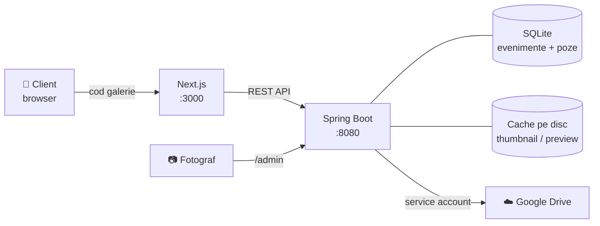

<div align="center">


# FotoIT

**Prinde Momente, Modelează Amintiri**

Site de prezentare pentru fotografie de evenimente, cu galerii private în care clienții
își văd, aleg și descarcă fotografiile pe baza unui cod unic.


</div>

---

## Capturi de ecran

<table>
  <tr>
    <td align="center" width="50%">
      
      <br /><sub><b>Pagina de prezentare</b> — portofoliu, despre și contact</sub>
    </td>
    <td align="center" width="50%">
      
      <br /><sub><b>Acces galerie</b> — clientul introduce codul primit de la fotograf</sub>
    </td>
  </tr>
</table>

## Ce face

**Pentru vizitatori**
- Prezentare, portofoliu în carusel cu vizualizare pe tot ecranul și contact direct (WhatsApp / email)
- Animații GSAP, design adaptat pentru telefon

**Pentru clienți** — galeria privată `/gallery/<COD>`
- Fotografiile evenimentului încărcate treptat, cu thumbnail-uri optimizate
- Vizualizare pe tot ecranul cu glisare (mouse sau touch), săgeți de tastatură și preîncărcarea pozelor vecine
- ❤️ Favorite salvate în browser și filtru „doar favorite”
- Selecție multiplă și descărcare ca arhivă ZIP, descărcarea întregii galerii sau a unei singure poze în calitate originală
- Distribuirea link-ului galeriei

**Pentru fotograf** — panoul de administrare `/admin`
- Creare evenimente (nuntă, majorat, eveniment) cu cod unic generat automat
- Sincronizare fotografii dintr-un folder Google Drive (inclusiv subfoldere)

## Cum funcționează



1. Fotograful încarcă pozele într-un folder Google Drive și creează evenimentul în `/admin`.
2. La **Sincronizare**, backend-ul citește lista de poze din Drive și pregenerează thumbnail-urile în fundal.
3. Clientul primește codul, îl introduce pe site și vede galeria.
4. Pozele vin mereu prin backend: thumbnail **800px**, preview **2048px** (ambele păstrate în cache) și originalul doar la descărcare.

## Pornire rapidă (Windows)

Ai nevoie de **Java 21+** și **Node.js 20+**.

```bat
start-dev.bat
```

Scriptul pornește backend-ul și frontend-ul în două ferestre separate, așteaptă să răspundă și deschide site-ul în browser.
La prima rulare instalează automat dependințele npm și creează `frontend/frontend/.env.local`.

| | Adresă |
|---|---|
| 🌐 Site | http://localhost:3000 |
| 🔐 Admin | http://localhost:8080/admin |
| 📚 Documentație API | http://localhost:8080/swagger-ui.html *(necesită login admin)* |

Oprire: `stop-dev.bat`.

<details>
<summary><b>Pornire manuală (orice sistem de operare)</b></summary>

```bash
# Terminal 1 — backend
cd backend
./mvnw spring-boot:run

# Terminal 2 — frontend
cd frontend/frontend
cp .env.example .env.local
npm install
npm run dev
```

</details>

## Configurare

### Google Drive
Backend-ul folosește un **service account** Google. Fișierul JSON cu cheia se pune în
`backend/src/main/resources/fotoit-gallery-credentials.json` (ignorat de git), iar folderele cu poze se partajează cu adresa contului de serviciu.
Alternativ, cheia poate fi dată prin variabila `GOOGLE_CREDENTIALS_JSON` sau `GOOGLE_APPLICATION_CREDENTIALS`.

### Variabile de mediu
Copiază `backend/local.env.example` ca `backend/local.env` (ignorat de git). `start-dev.bat` îl citește automat.

| Variabilă | Implicit | Rol |
|---|---|---|
| `ADMIN_PASSWORD` | *generată la pornire* | Parola pentru `/admin` (utilizator `admin`). Fără ea, la fiecare pornire se generează o parolă nouă, afișată în fereastra backend-ului. |
| `ADMIN_USERNAME` | `admin` | Utilizatorul pentru `/admin` |
| `CORS_ALLOWED_ORIGINS` | `http://localhost:3000` | Domeniile frontend-ului, separate prin virgulă |
| `NEXT_PUBLIC_API_URL` | `http://localhost:8080` | În `frontend/frontend/.env.local`: adresa backend-ului |

Alte setări (dimensiuni thumbnail/preview, limita ZIP, limita de încercări pentru coduri) sunt în
`backend/src/main/resources/application.properties`.

## API public

| Metodă | Endpoint | Descriere |
|---|---|---|
| `GET` | `/api/gallery/{cod}` | Datele galeriei și lista de poze (opțional `?page=&size=`) |
| `GET` | `/api/gallery/thumbnail/{fileId}` | Thumbnail 800px (JPEG, din cache) |
| `GET` | `/api/gallery/preview/{fileId}` | Preview 2048px pentru vizualizare pe tot ecranul |
| `GET` | `/api/gallery/image/{fileId}` | Fișierul original, afișat în browser |
| `GET` | `/api/gallery/download/{fileId}` | Fișierul original, ca descărcare |
| `POST` | `/api/gallery/download/zip?code={cod}` | Arhivă ZIP cu pozele selectate (JSON sau formular) |
| `GET` | `/api/gallery/{cod}/download-all` | Arhivă ZIP cu toată galeria |

## Securitate

- `/admin` și documentația API sunt protejate cu login, iar formularele din admin au protecție CSRF
- Se servesc doar fotografii care aparțin unei galerii existente, nu orice fișier din Google Drive
- Arhivele ZIP verifică faptul că toate pozele cerute aparțin galeriei respective
- Căutarea după cod e limitată la 30 de încercări pe minut de pe același IP, ca să nu poată fi ghicite codurile
- CORS e limitat la domeniile configurate, iar mesajele de eroare nu expun detalii interne
- Credențialele, baza de date și fișierele `local.env` / `.env.local` sunt excluse din git

## Structura proiectului

```
fotoit.v2/
├── backend/                     Spring Boot + SQLite
│   ├── src/main/java/.../
│   │   ├── config/              securitate, Google Drive, Swagger
│   │   ├── controller/          API galerie + panou admin
│   │   ├── service/             evenimente, Google Drive, thumbnail-uri
│   │   └── security/            limitarea încercărilor de cod
│   ├── src/main/resources/      application.properties, template-uri admin
│   └── local.env.example
├── frontend/frontend/           Next.js 16 + Tailwind 4
│   ├── app/                     pagina principală, /gallery/[code]
│   ├── components/              layout, galerie, lightbox, secțiuni
│   └── lib/                     client API, descărcări, date site
├── start-dev.bat / stop-dev.bat
└── deploy-aws.sh                deploy opțional pe un server Ubuntu (EC2)
```

## Note

- Baza de date `backend/fotoit.db` nu e în git. Fă-i backup separat (de exemplu în `backups/`, folder ignorat de git).
- Cache-ul de imagini (`backend/cache/`) poate fi șters oricând; se regenerează automat.
- Pentru imaginile din portofoliu există un script de optimizare: `frontend/frontend/scripts/downscale-images.py`.

---

<div align="center">
<sub>© FotoIT · <a href="https://github.com/crisanalex15/FotoIT">github.com/crisanalex15/FotoIT</a></sub>
</div>
